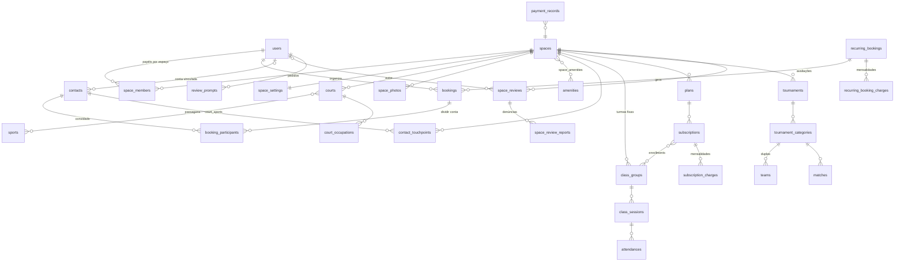

# 04 · Modelo de Dados (v3)

Todas as tabelas têm `id (uuid v7)`, `created_at`, `updated_at`. Valores em centavos (`*_cents int`). Datas em `timestamptz`.

## Diagrama (resumo)

## Identidade e acesso
- **users**: name, email? (minúsculo, único quando presente), email_verified, email_verified_at? (primeira vez em que a conta apareceu verificada; marca a transição que dispara o vínculo por e-mail, RN-CONTACT-03), phone? (E.164; obrigatório no cadastro por e-mail e gravado sem verificação, decisão 64; nulo em conta antiga ou criada pelo login social até o "completar cadastro"), phone_verified (só o OTP marca; migração `0023`: o UNIQUE de `phone` virou índice único parcial `users_phone_verified_unique` onde `phone_verified`, então números digitados podem se repetir), avatar_url? (foto de perfil, RF-AUTH-02: URL pública da foto enviada, publicada no storage em `users/<id>/avatar/<uuid do upload>-<uuid novo>.<ext>`, ou URL externa, como a foto do Google, decisão 71; nula = iniciais do nome. Só muda por `/v1/me/avatar`: o Better Auth recusa `image` no cadastro e no update-user. Trocar ou remover apaga do storage a foto anterior só se ela for uma foto enviada pelo próprio usuário; a anonimização zera o campo e, depois do commit, apaga tudo sob `users/<id>/` no storage), birth_date? (`date`, data civil sem fuso, decisão 68), gender? (enum `gender`: `FEMALE|MALE|OTHER|UNDISCLOSED`; a `0023` converteu o texto livre, sem uso: valores do enum ficam, o resto vira nulo), `platform_role` (`USER|SUPER`), status (`ACTIVE|BLOCKED|INACTIVE`; `INACTIVE` = inativada pelo titular no app, RF-AUTH-03), deleted_at. CHECK: e-mail ou telefone; telefone em E.164. É a tabela de usuários do Better Auth (o `phoneNumber`/`phoneNumberVerified` do Better Auth são `phone`/`phone_verified`); a exclusão (hoje só pelo atendimento LGPD do Super) anonimiza e-mail, telefone, foto, nascimento e gênero e apaga os esportes favoritos.
- **sessions / accounts / verifications**: tabelas do Better Auth (sessão por cookie no web e bearer no app; credenciais por provedor; tokens de verificação/OTP).
- **user_sport_profiles**: esportes favoritos (decisão 69). user_id, sport_id (FK com `ON DELETE CASCADE`: tirar o esporte do catálogo leva os favoritos, sem travar o Super), level? (`BEGINNER|INTERMEDIATE|ADVANCED|PRO`; nulo = não informado, desde a `0023`) — unique(user_id, sport_id). `PATCH /v1/me/profile` troca a lista inteira.
- **space_members**: user_id, space_id, role (`OWNER|ADMIN|TEACHER`; migração `0019` converteu o papel removido na decisão 46 em `ADMIN`), status (`INVITED|ACTIVE|REMOVED`) — unique(user_id, space_id, role); unique(id, space_id) é o alvo da FK composta dos professores das turmas/sessões. A mesma pessoa pode ter vínculos em vários espaços.
- **staff_invites**: space_id, email (minúsculo), role (`OWNER|ADMIN|TEACHER`), token_hash (SHA-256; o token só vai por e-mail), status (`PENDING|ACCEPTED|REVOKED`), expires_at (7 dias; vencido = `PENDING` com prazo passado, reenviável), invited_by, accepted_by?, accepted_at? — unique parcial (space_id, email, role) onde `PENDING`. Convite para quem ainda não tem conta; ao aceitar vira linha ACTIVE em `space_members`. Só a conta com o e-mail convidado, verificado, aceita.
- **devices**: user_id, expo_push_token (único: o token segue o último login no aparelho), platform (`IOS|ANDROID`)

## Catálogo (gerido no Super)
- **cities**: name, state, timezone, active
- **sports**: slug (`futevolei`, `beach-tennis`, `volei-praia`), name, icon, default_max_players
- **amenities**: slug, name, icon

## Espaço
- **spaces**: name, slug, description, city_id, address (rua, nº, bairro, cep), location `geography(Point,4326)`, phone, whatsapp, instagram, logo_url (RF-SPACE-11, opcional), status (`ACTIVE|SUSPENDED|CLOSED`; nasce `ACTIVE`, todos os módulos liberados), rating_count e rating_sum (int, padrão 0; avaliações que contam na média e a soma das notas, RN-REVIEW-03; check `spaces_rating_consistent`: soma entre a contagem e 5 × a contagem; ver "Avaliações")
- **space_settings** (1:1): price_per_hour_cents, booking_min_duration_min, booking_max_duration_min, booking_min_advance_min, booking_window_days, cancellation_deadline_min, recurring_monthly_price_cents, recurring_billing_day, attendance_mode (`AUTOMATIC|MANUAL`), attendance_open_before_min, attendance_close_before_min, attendance_cancel_deadline_min, past_due_block_enabled (RN-CLASS-06 ligada/desligada), past_due_block_days, accepted_payment_methods[]
- **space_opening_hours**: space_id, weekday, opens_at, closes_at
- **space_photos**: space_id, url, blurhash, position
- **space_amenities**: space_id, amenity_id
- **courts**: space_id, name, covered, status (`ACTIVE|MAINTENANCE|INACTIVE`)
- **court_sports**: court_id, sport_id, max_players (não vem do cadastro: é `sports.default_max_players`, ou 20 se o esporte não tiver padrão, e acompanha a mudança do padrão no Super; decisão 51)
- **favorites**: user_id, space_id

## Agenda (fonte única)
- **court_occupations**: court_id, period `tstzrange`, kind (`BOOKING|CLASS|TOURNAMENT|BLOCK`), ref_id, active
  `EXCLUDE USING gist (court_id WITH =, period WITH &&) WHERE (active)`

## Aluguel
- **bookings**: space_id, court_id, organizer_user_id?, guest_name?, guest_phone? (balcão sem app), sport_id, starts_at, ends_at, duration_min, people_count, price_per_hour_cents (snapshot), price_cents (0 em ocorrências de mensalista), discount_cents (abatimento do estorno online, decisão 93), status (`PENDING_PAYMENT|CONFIRMED|COMPLETED|CANCELLED|NO_SHOW`; `PENDING_PAYMENT` segura o horário até `payment_due_at`, RN-ONPAY-02), payment_due_at?, idempotency_key?, payment_status (`PENDING|PARTIALLY_PAID|PAID`), intended_payment_method, source (`APP|DESK|RECURRING`), recurring_booking_id?, cancelled_at, cancelled_by, cancel_reason, cancelled_by_pause (ocorrência de mensalista cancelada pela pausa; só estas voltam na retomada), reminder_sent_at? (job de lembrete; nulo = ainda sem lembrete; volta a nulo quando o organizador muda o início); `UNIQUE(recurring_booking_id, starts_at)` garante uma ocorrência por mensalista e horário (geração idempotente)
- **booking_participants**: booking_id, user_id?, invite_token, name?, share_cents (só informativo), status (`INVITED|ACCEPTED|DECLINED`), contact_id? (`ON DELETE SET NULL`), contact_via_email (o convite citou o e-mail do contato antes de a conta verificá-lo; só esses vão para a conta na verificação, RN-CONTACT-03). O `payment_status` saiu na migração `0019` (decisão 50)
- **recurring_bookings** (mensalista): space_id, court_id, user_id?, guest_name?, guest_phone?, sport_id, weekday, start_time, duration_min, people_count, starts_on, ends_on?, status (`PENDING_APPROVAL|ACTIVE|PAUSED|ENDED|REJECTED`), status_reason? (motivo ao recusar/pausar/encerrar)
- **recurring_booking_charges** (mensalidade do mensalista): recurring_booking_id, period_start, period_end, due_date, amount_cents (copiado de `space_settings.recurring_monthly_price_cents` na geração), status (`PENDING|PAID|OVERDUE|WAIVED`)
- **recurring_booking_conflicts**: recurring_booking_id, starts_at, ends_at, conflicts_with (`BOOKING|CLASS|TOURNAMENT|BLOCK`), resolved_at? — ocorrência que não coube na agenda, sinalizada para a gestão pelo job; fica aberta (`resolved_at` nulo) até a ocorrência ser gerada ou o mensalista ser pausado/encerrado
- **court_blocks**: court_id, period, reason, created_by

## Contatos
Migração `0022` (decisão 48, RF-CONTACT-01 a RF-CONTACT-08).
- **contacts**: name?, email? (normalizado), phone? (E.164), user_id? (conta vinculada, `ON DELETE SET NULL`), marketing_consent_at?, unsubscribed_at?. Pelo menos e-mail ou telefone (`contacts_email_or_phone`); únicos entre si por índices parciais (`contacts_email_unique`, `contacts_phone_unique`). E-mail só entra na criação do contato (RN-CONTACT-02)
- **contact_touchpoints**: contact_id (`ON DELETE CASCADE`), origin (`BOOKING_INVITE_ORGANIZER|BOOKING_INVITE_SELF|DESK_BOOKING|RECURRING_DESK`), space_id, booking_id? (nulo no mensalista de balcão), captured_by? (nulo quando foi o próprio convidado), name?, email?, phone? (como foram informados ali, mesmo que não tenham entrado em `contacts`), marketing_consent_at? (consentimento dado ali). A gestão de um espaço lê só os touchpoints dele; `contacts` é global e só o Super o lê (decisão 48)

## Aulas
Migração `0012_classes` (tarefa 2.1). Turmas, sessões, assinaturas e planos têm FKs compostas com `space_id` (quadra, professor, turma e plano sempre do mesmo espaço).
- **class_groups** (turma fixa): space_id, sport_id, court_id, name, level? (`sport_level`; nulo = todos os níveis), weekday (0 = domingo), start_time (hora local do espaço, `HH:00`/`HH:30`), duration_min (múltiplo de 30), capacity (máx. de matrículas ativas, RN-CLASS-02), active
- **class_group_teachers** (migração `0021`, decisão 47): class_group_id, space_id, teacher_member_id (→ `space_members`, vínculo `TEACHER`) — PK (class_group_id, teacher_member_id). Professores padrão da turma. FKs compostas com `space_id` para a turma e para o vínculo; ao menos um professor, garantido por gatilho adiado ao commit (`class_groups_require_teacher` na criação, `class_group_teachers_keep_one` na remoção)
- **class_sessions**: class_group_id, space_id, court_id, starts_at, ends_at, capacity (copiada da turma; ajustável pela gestão), status (`SCHEDULED|OPEN|CLOSED|DONE|CANCELLED`), opened_at, opened_by, closed_at, closed_by, cancelled_at, cancelled_by, cancel_reason — `UNIQUE(class_group_id, starts_at)`; ocupa a quadra em `court_occupations` (kind `CLASS`, ref_id = sessão). Geradas pelo job com 4 semanas de antecedência, uma por turma e data local (a cancelada não é recriada)
- **class_session_teachers** (migração `0021`): class_session_id, space_id, teacher_member_id — PK (class_session_id, teacher_member_id). Copiada da turma na geração e editável por aula; as mesmas FKs compostas e o mesmo mínimo de um professor (`class_sessions_require_teacher`, `class_session_teachers_keep_one`). A lista das aulas encerradas é histórico. A aula gerada sem um professor em conflito (RN-CLASS-09) fica com a lista diferente da turma e, como toda aula de lista própria, deixa de seguir as trocas de professores da turma; quem ficou de fora também não volta sozinho quando o horário libera
- **teacher_occupations** (migração `0021`, RN-CLASS-09): user_id, space_id, class_session_id, period `tstzrange`, active — unique(class_session_id, user_id). Agenda do professor entre espaços, por `users.id`, uma linha por professor e aula, mantida na mesma transação das listas. `teacher_occupations_no_overlap`: `EXCLUDE USING gist (user_id WITH =, period WITH &&, space_id WITH <>) WHERE (active)`. Aula cancelada fica inativa. Quem grava serializa por professor com `pg_advisory_xact_lock` (`teacher-schedule:<user_id>`). Na migração, sobreposições antigas entre espaços não travam: a aula mais antiga fica ativa e a outra entra com `active = false`, e segue como está até a gestão resolver
- **class_session_conflicts**: class_group_id, starts_at, ends_at, conflicts_with (`class_conflict_kind`: `BOOKING|CLASS|TOURNAMENT|BLOCK|TEACHER`), resolved_at? — sessão que não coube na agenda, sinalizada pelo job (mesmo padrão de `recurring_booking_conflicts`). `TEACHER`: todos os professores da turma têm aula em outro espaço no horário
- **attendances**: session_id, user_id, status (`CONFIRMED|WAITLIST|CANCELLED|PRESENT|ABSENT`), waitlist_position? (só em `WAITLIST`, CHECK), added_by_staff (bool) — `UNIQUE(session_id, user_id)`. Choque de horário (decisão 37): o aluno não entra na lista de uma aula que se sobrepõe a outra em que está `CONFIRMED`, `WAITLIST` ou `PRESENT`; serializado por aluno com `pg_advisory_xact_lock` (`student-schedule:<user_id>`), a mesma trava da matrícula
- **plans**: space_id, sport_id, name, weekly_frequency (1 a 7, ou null = ilimitado nas turmas matriculadas), price_cents, billing_day (1 a 28, dia fixo do mês, sem pró-rata — decisão 25), active
- **subscriptions**: user_id, plan_id, space_id, status (`PENDING_APPROVAL|ACTIVE|PAST_DUE|CANCELLED`), price_cents (snapshot do plano no pedido), starts_on? (data da aprovação), current_period_start?, current_period_end? (nulos até a aprovação), intended_payment_method?, cancel_at_period_end + ends_on? (último dia de serviço = fim do último mês pago ou dispensado, RN-CLASS-08; CHECK: `cancel_at_period_end` exige `ends_on`; no cancelamento imediato, `CANCELLED` com `ends_on` = o dia do cancelamento e `cancel_at_period_end` falso), cancel_requested_at?, approved_at?, approved_by?, rejected_at? (recusa = `CANCELLED` com rejected_at), cancelled_at?, cancelled_by?, status_reason?, billing_processed_on? (último dia local em que o job de mensalidades passou pela assinatura; migração `0014`) — unique parcial (user_id, plan_id) onde o status é `PENDING_APPROVAL|ACTIVE|PAST_DUE`. Migração `0013_subscriptions` (tarefa 2.2) acrescentou as colunas depois de `cancel_at_period_end`. A pausa saiu na migração `0020_remove_subscription_pause` (decisão 45): `PAUSED` voltou a `ACTIVE`, as pausas agendadas foram descartadas e o mês em curso que estava trancado ficou com mensalidade `WAIVED`, para o job não gerar cobrança retroativa
- **enrollments**: subscription_id, class_group_id, status (`PENDING|ACTIVE|ENDED`; `PENDING` = turma escolhida no pedido, não ocupa vaga), started_on, ended_on? — vínculo do aluno com a turma fixa; unique parcial (subscription_id, class_group_id) onde `ACTIVE`
- **subscription_charges** (mensalidades): subscription_id, period_start, period_end (o mês do calendário), due_date (`billing_day` do plano), amount_cents (preço da assinatura, sem pró-rata), status (`PENDING|PAID|OVERDUE|WAIVED`), due_reminder_sent_at? e overdue_notified_at? (avisos do job, uma vez cada), waived_at?/waived_by?/waive_reason? (CHECK: `WAIVED` ⇔ waived_at; o motivo vem da dispensa pela gestão ou é o texto fixo do cancelamento imediato, RN-CLASS-08; só a gestão vê o motivo) — `UNIQUE(subscription_id, period_start)`. Pagamentos em `payment_records` com payable_type `SUBSCRIPTION_CHARGE`

## Torneios
- **tournaments**: space_id, sport_id, name, slug, description, rules, banner_url, starts_on, ends_on, registration_opens_at, registration_closes_at, status, draw_seed
- **tournament_categories**: tournament_id, name, gender (`M|F|MIXED|OPEN`), level, team_size (padrão 2), max_teams, fee_cents, format (`SINGLE_ELIM|DOUBLE_ELIM|ROUND_ROBIN|GROUPS_KNOCKOUT`), format_settings (jsonb: grupos, classificados, sets, pontos)
- **teams** (dupla): category_id, name, seed?, status (`PENDING_PARTNER|PENDING_PAYMENT|CONFIRMED|WAITLIST|CANCELLED`), payment_status
- **team_members**: team_id, user_id, invite_token, status (`INVITED|ACCEPTED|DECLINED`)
- **stages / groups / rounds**: estrutura do chaveamento (compatível com brackets-manager)
- **matches**: category_id, stage_id, round, position, team_a_id, team_b_id, court_id, scheduled_at, score (jsonb por set), winner_team_id, status, next_match_id, loser_next_match_id

## Registro de pagamentos (no espaço)
- **payment_records**: space_id, payable_type (`BOOKING|BOOKING_PARTICIPANT|RECURRING_BOOKING_CHARGE|SUBSCRIPTION_CHARGE|TEAM`), payable_id, payer_user_id?, amount_cents, method (`PIX|CARD|CASH|OTHER`), channel (`ON_SITE|ONLINE`), online_charge_id?, paid_at, recorded_by? (nulo no online), reversed_at?, reversed_by? (nulo quando o sistema estorna), note. `BOOKING_PARTICIPANT` e `RECURRING_BOOKING_CHARGE` só existem em registros antigos (decisões 50 e 27); os por parte seguem no total pago da reserva

## Plataforma
- **onboarding_checklists**: space_id, items (jsonb: dados, fotos, quadras, preço, equipe, turmas, planos), completed_at
- **notifications**: user_id, type, title, body, data, read_at (central do usuário; paginada por id, uuid v7)
- **notification_preferences**: user_id, type, push_enabled, in_app_enabled — único por (user_id, type); sem linha = tudo ligado
- **push_deliveries**: id (chave de idempotência do push, gerada ao enfileirar), user_id, created_at — gravada antes do envio ao Expo, impede push duplicado quando o job roda de novo; apagada depois de 24 h
- **audit_logs**: actor_id, acting_as_super (bool), space_id?, action, entity, entity_id, diff

## Anúncios
Decisões 73 a 79; requisitos RF-ADS e RN-ADS; migração `0024_ads`. Só o Super acessa (RN-ADS-02); a entrega pública lê as campanhas no ar e os eventos só somam contadores.
- **advertisers**: name, kind (`COMPANY|SPACE`), space_id? (obrigatório se `SPACE` e proibido em `COMPANY`, check `advertisers_space_kind`; único entre anunciantes ativos, índice parcial `advertisers_space_id_active_unique`), category (`SPORTING_GOODS|APPAREL|SUPPLEMENTS|FOOD_BEVERAGE|HEALTH|FITNESS|SPORTS_SPACE|EVENTS|SERVICES|OTHER`; sem `BETTING` nem `ALCOHOL`, decisão 75), contact_name?, contact_email?, contact_phone? (E.164), notes?, active, created_at, updated_at. Tipo e espaço não mudam depois de criados
- **ad_campaigns**: advertiser_id, name, placement (`EXPLORE_HERO|EXPLORE_FEED`), starts_at, ends_at (timestamptz, check `ends_at > starts_at`), city_ids (uuid[], vazio = todas), sport_ids (uuid[], vazio = todos), weight (1–10, check), status (`DRAFT|ACTIVE|PAUSED|ARCHIVED`), created_by? (nulo no seed), created_at, updated_at. Índice para a entrega por (placement, status, starts_at, ends_at). Os arrays não têm FK: a API confere cidades e esportes ao gravar. A vaga só muda enquanto a campanha não tem peças
- **ad_creatives**: campaign_id, image_url? (opcional só para anunciante `SPACE` com destino `SPACE`, conferido pela API), title (1–40), body? (1–90), cta_label (1–20), destination_type (`URL|WHATSAPP|SPACE`), destination_url?, whatsapp_phone?, whatsapp_message?, destination_space_id?, active, position, created_at, updated_at. Check `ad_creatives_destination_valid`: URL só `https://`; WhatsApp com telefone E.164 e mensagem (1–500); espaço com o id; as colunas dos outros tipos ficam nulas. Imagens publicadas em `ads/<campaignId>/<uuid do upload>-<uuid novo>.<ext>` no bucket de mídia (decisão 72); a duplicação copia para `ads/<nova campanha>/<uuid>.<ext>`. Sem exclusão: a peça é desativada (os contadores apontam para ela)
- **ad_daily_stats**: chave primária (creative_id, day); campaign_id, placement, day (date em `America/Sao_Paulo`, o dia em que o evento chegou), impressions, clicks (≥ 0), created_at, updated_at — incrementado por upsert; sem usuário, aparelho ou IP
- **ad_event_receipts**: chave primária (delivery_id, kind); delivery_id (id aleatório do token de entrega), kind (`IMPRESSION|CLICK`), expires_at (validade do token), created_at — impede contar duas vezes o mesmo token; o job diário (`ads-maintenance`, 04:00) apaga os vencidos

Ajustes na implementação: `ad_daily_stats` e `ad_event_receipts` usam chave primária composta (sem `id`); `ad_event_receipts` ganhou `expires_at` para a limpeza; `ad_campaigns` ganhou `created_by`; `advertisers` não tem `created_by` (a auditoria registra quem criou).

## Pagamento online
Decisões 80 a 98; RF-ONPAY/RN-ONPAY; `13-pagamentos-online.md`; migrações `0025_online_payments` (tarefa PG.2), `0026_payout_change` (PG.2b), `0027_payout_change_id` (revisão da PG.2b) e `0028_idempotency_request_hash`. Valores em centavos, percentuais em pontos-base. As tabelas espelham o gateway (a plataforma não guarda saldo, decisão 81).
- **platform_fee_settings** (linha única, `id = 1`, check): pix_fee_bps, card_fee_bps (0 a 10000), min_fee_cents, fee_payer (`SPACE|PLAYER`, padrão `SPACE`), updated_by?, created_at, updated_at. A migração grava o padrão da decisão 83 (400, 600, 100, `SPACE`); o seed de produção recria a linha se faltar.
- **space_payment_settings**: space_id (único, `ON DELETE CASCADE`), booking_mode (`ON_SITE|ONLINE_OPTIONAL|ONLINE_REQUIRED`, padrão `ON_SITE`), class_mode (`ON_SITE|ONLINE_OPTIONAL`), pix_fee_bps?, card_fee_bps?, min_fee_cents?, fee_payer? (nulos = padrão, campo a campo), updated_by?. Sem linha: `ON_SITE` e a taxa padrão. Na leitura, os modos valem só com o gateway ligado, o espaço `ACTIVE` e a subconta já aprovada (`approved_at`).
- **merchant_accounts**: space_id (único, cascade), provider, provider_account_id? (único com provider), status (`NOT_STARTED|PENDING|APPROVED|REJECTED`), document_type (`CPF|CNPJ`), **document_encrypted** (completo e cifrado na aplicação, AES-256-GCM com a chave `PAYMENTS_DATA_KEY` e o space_id como dado associado, formato `v1.<iv>.<tag>.<cifrado>`; decifrado só no relatório fiscal do Super, leitura auditada, decisão 97), document_masked, legal_name, responsible_name, responsible_cpf_masked? (CPF do responsável, só no cadastro com CNPJ: vai ao gateway e fica **só mascarado**, minimização da LGPD; a coluna cifrada da 0026 saiu na 0027), email, payout_kind (`BANK_ACCOUNT|PIX_KEY`), payout_masked (a conta nunca completa: a aprovada ou, com uma troca em análise, a nova), payout_change_id? (id da troca mais recente, mandado ao gateway como chave de idempotência; a decisão só vale para a troca com esse id; nulo no cadastro e nas trocas antigas; migração 0027), previous_payout_kind?/previous_payout_masked? (a conta aprovada guardada durante a troca), rejected_payout_masked?, payout_change_rejection_reason? e payout_change_rejected_at? (a última troca recusada, decisão 98; limpos na próxima troca), rejection_reason? (recusa do cadastro), terms_accepted_at, submitted_by, submitted_at, approved_at?, rejected_at?. A troca da conta (decisão 95) é gravada antes da chamada ao gateway e volta o status a `PENDING`, mantendo `approved_at`: repasses pausados (`PENDING` com `approved_at`), cobranças seguem. Aprovada, `approved_at` é atualizado e a conta guardada é descartada; recusada (decisão 98), volta a conta guardada com o status `APPROVED` (sem conta guardada, numa troca antiga, fica a atual) e a recusa fica nos campos da troca. Com `approved_at`, o cadastro não é reenviado (409 `MERCHANT_ACCOUNT_APPROVED`).
- **online_charges**: space_id, payable_type (`BOOKING|SUBSCRIPTION_CHARGE`, check), payable_id, payer_user_id, provider (o estorno vai sempre por ele), provider_charge_id? (nulo até o gateway responder; `PENDING` sem ele = criação ainda em andamento ou de resultado desconhecido, **pendente de verificação**, resolvida pela idempotency_key; único com provider), method (`PIX|CARD`), status (`PENDING|PAID|EXPIRED|FAILED|CANCELLED|PARTIALLY_REFUNDED|REFUNDED|CHARGEBACK`), amount_cents (pago pelo jogador), service_amount_cents (saldo em aberto do item), platform_fee_cents, gateway_cost_cents (tarifa, custo da plataforma), space_net_cents, fee_payer, fee_bps, min_fee_cents (snapshot), refunded_cents (estornos + chargebacks), fee_refunded_cents, pix_copy_paste?, pix_qr_svg?, card_brand?, card_last4?, expires_at?, paid_at? (também numa cobrança fechada que recebeu pagamento tardio, decisão 96), failure_reason? (código), closed_reason? (`REPLACED|PAID_ON_SITE|BOOKING_CANCELLED|BOOKING_CHANGED|SPACE_INACTIVE|ACCOUNT_DELETED|EXPIRED`), idempotency_key (único, a chave das chamadas ao gateway e da consulta da criação de resultado desconhecido), request_key? e request_hash? (`Idempotency-Key` do app e o hash do pedido, item e meio, da 0028: a chave com outro pedido é recusada; único com payer_user_id, e a busca filtra pelo pagador). Índices: uma `PENDING` por (payable_type, payable_id) (RN-ONPAY-03); `PENDING` por expires_at (job). Checks: split coerente com fee_payer (`SPACE`: amount = service e net = amount − fee) e estornos dentro do valor e da taxa.
- **online_refunds**: charge_id, space_id, kind (`REFUND|CHARGEBACK`), status (`PENDING|SUCCEEDED|FAILED`), amount_cents, fee_refund_cents (regra acumulada, decisão 94), reason?, reason_code (`MANUAL|BOOKING_CANCELLED_BY_PLAYER|BOOKING_CANCELLED_BY_SPACE|ACCOUNT_DELETED|PAID_AFTER_DEADLINE|PAID_AFTER_METHOD_CHANGE|ITEM_ALREADY_PAID|CHARGEBACK|EXTERNAL`), requested_by? (nulo no automático), charge_again (decisão 93), item_discount_cents (parte que virou abatimento), provider_refund_id? (único com charge_id; nulo num estorno `PENDING` que ainda não chegou ao gateway, por falha ou provedor indisponível, e que a reconciliação conclui com o id do estorno como chave), applied_at? (já no livro-razão e no registro). Estornos `PENDING` não aplicados descontam do saldo reembolsável e entram na taxa acumulada, dispute_status? (só no chargeback: `AWAITING_RESPONSE|RESPONDED|WON|LOST`), dispute_respond_by?, dispute_response_text?, dispute_attachment_urls (text[]), dispute_responded_at?, dispute_responded_by?, dispute_resolved_at?
- **gateway_events**: provider, event_id (único com provider), type, payload (jsonb), received_at, processed_at?, attempts, error?. Índice parcial dos não processados (reconciliação).
- **space_ledger_entries**: space_id, charge_id?, refund_id?, payout_id?, kind (`SALE|PLATFORM_FEE|REFUND|FEE_REFUND|CHARGEBACK|PAYOUT|ADJUSTMENT`), amount_cents (com sinal; check por tipo), available_at, description?, created_at (data do lançamento: a receita e o relatório da NFS-e do Super são por ela, então o mês fechado não muda). Saldo = soma; disponível = soma com `available_at <= agora`. Únicos parciais por (charge_id, kind) sem refund/payout, (refund_id, kind) e (payout_id, kind): reprocessar um evento não duplica. Venda e taxa nascem com a data de liberação do gateway (Pix D+1, cartão D+30 no fake); estorno e chargeback valem na hora, ou na data da venda se ela ainda não liberou (saem do "a liberar"; a liberação move venda, taxa e esses estornos juntos); repasse vale na hora; a contestação ganha entra como `ADJUSTMENT` (+valor) e `PLATFORM_FEE` (−taxa devolvida) do próprio chargeback; o repasse que falha volta como `ADJUSTMENT`.
- **payouts**: space_id, provider, provider_payout_id (único com provider), amount_cents, status (`SCHEDULED|PAID|FAILED`, só avança), scheduled_for, paid_at?, failure_reason?
- **fake_gateway_objects**: namespace do gateway simulado (`PAYMENTS_PROVIDER=fake`): id (texto), kind (`account|charge|payout`), account_id?, data (jsonb). Só o adaptador fake lê e escreve.
- Alterações: `booking_status` ganha `PENDING_PAYMENT`; `bookings` ganha `payment_due_at?` (índice parcial; o valor novo do enum não pode aparecer na mesma migração), `discount_cents` (abatimento, decisão 93; check ≤ preço) e `idempotency_key?` (único com organizer_user_id) e, na 0028, `idempotency_request_hash?` (SHA-256 do pedido: a mesma chave com outro pedido responde `IDEMPOTENCY_KEY_REUSED`); `cancel_reason` aceita `PAYMENT_EXPIRED` e `PAYMENT_ABANDONED`. `subscription_charges` ganha `discount_cents`. `payment_records` ganha `channel` (`ON_SITE|ONLINE`, padrão `ON_SITE`) e `online_charge_id?` (FK); `recorded_by` passa a aceitar nulo (online, check `payment_records_channel_consistent`) e `reversed_by` também (estorno pelo sistema). O pagamento online parcialmente estornado fica com o valor líquido no registro (decisão 93).

Ajustes em relação à proposta: `online_charges` ganhou `closed_reason`, `request_key`, `card_brand`/`card_last4` e `fee_refunded_cents`; `online_refunds` ganhou `space_id`, `reason_code`, `charge_again`, `item_discount_cents`, `applied_at` e os campos da contestação; `merchant_accounts` ganhou `document_encrypted` (completo e cifrado, decisões da revisão da PG.1 e 97), `responsible_name`, `email`, `payout_kind`, `terms_accepted_at` e `rejected_at` e, na PG.2b (migrações 0026 e 0027), o CPF do responsável só mascarado (`responsible_cpf_masked`), o id da troca (`payout_change_id`) e os campos da troca recusada (decisão 98); `gateway_events` ganhou `attempts`; e a tabela do fake.

## Avaliações
Decisões 99 a 108; RF-REVIEW/RN-REVIEW (seção 12 de `02-requisitos-funcionais.md`); migrações `0029_reviews` (tarefa AV.2) e `0030_reviews_polish` (AV.6a: `review_prompts.answered_at` e `space_review_reports.resolution_reason`). Enums conforme `packages/shared/src/reviews.ts`.
- **space_reviews**: space_id, user_id? (nulo depois da anonimização da conta, decisão 105), rating (smallint, check 1–5), tags (array de `review_tag`, padrão vazio, check até 5; 8 pares positivo/negativo na ordem da AV.1: `GOOD_COURT|BAD_COURT|GOOD_SERVICE|BAD_SERVICE|CLEAN|DIRTY|GOOD_VALUE|EXPENSIVE|EASY_BOOKING|HARD_BOOKING|GOOD_LIGHTING|BAD_LIGHTING|ON_TIME|DELAYS|GOOD_FACILITIES|POOR_FACILITIES`; positivos só com nota 4–5 e negativos só com 1–3, conferido pela API), comment? (check até 500), author_kind (`PLAYER|STUDENT`, do uso mais recente), counted (bool, padrão true: entra na média e nas listas; falso enquanto o autor está bloqueado), comment_hidden_at?, comment_hidden_by?, comment_hidden_reason? (moderação do Super; a nota continua na média), reply? (check até 500), reply_by?, replied_at? (check: com resposta ⇔ com `replied_at`), reply_updated_at?, reply_notified_at? (quando o autor foi avisado da primeira resposta, `REVIEW_REPLIED`; fica mesmo se a resposta for removida, então editar ou remover e responder de novo não avisa outra vez), created_at, updated_at (só a edição pelo autor o renova: resposta, moderação, bloqueio e anonimização não). Único parcial `space_reviews_space_user_unique` (space_id, user_id) onde user_id não é nulo; índice da lista (space_id, created_at desc, id desc); índice por user_id.
- **space_review_reports**: review_id (cascade), reporter_user_id, reporter_space_id? (denúncia feita pela gestão do espaço), reason (`SPAM|OFFENSIVE|FALSE_INFO|PERSONAL_DATA|OTHER`), details? (check até 500), status (`OPEN|RESOLVED|DISMISSED`, padrão `OPEN`; ocultar o comentário resolve as abertas da avaliação), resolved_by?, resolved_at?, resolution_reason? (check até 500: o motivo opcional do descarte, ou o motivo da ocultação do comentário que a resolveu), created_at, updated_at. Único (review_id, reporter_user_id); índices (status, created_at, id) para a fila do Super e por reporter_user_id. Apagadas na exclusão da conta de quem denunciou.
- **review_prompts**: user_id, space_id, source_type (`BOOKING|CLASS_SESSION`), source_id (bookings.id ou class_sessions.id, sem FK), sent_at, answered_at? (o `created_at` da avaliação criada até 7 dias depois do pedido, gravado na mesma transação da criação; fica se a avaliação for editada ou excluída), notification_id? (FK `notifications`, `ON DELETE SET NULL`; nulo com a central desligada), created_at, updated_at. Único (user_id, source_type, source_id): o mesmo uso nunca gera dois pedidos; índice (user_id, space_id, sent_at) para os 30 dias e os ignorados (sem `answered_at` e com mais de 7 dias). Apagados na exclusão da conta. A `0030` preencheu `answered_at` dos pedidos antigos cuja avaliação ainda existia; os respondidos com a avaliação já excluída não têm como ser recuperados.
- **review_created_notices**: user_id, space_id, created_at, updated_at. Único (user_id, space_id). Marca que a pessoa já avaliou o espaço alguma vez: a gestão recebe `REVIEW_CREATED` só na primeira avaliação de cada (autor, espaço) e não de novo ao editar, nem ao excluir e avaliar outra vez (a marca sobrevive à exclusão da avaliação). Sem outro dado pessoal além do user_id; apagada na exclusão da conta.
- Índices novos para o job de pedidos: `bookings_ends_at_reviewable_idx` (ends_at, onde `CONFIRMED`/`COMPLETED`) e `class_sessions_ends_at_idx` (ends_at, onde não `CANCELLED`).

Ajustes em relação à proposta: `space_reviews` ganhou `counted` (o bloqueio tira a nota da média sem apagar nada, e a nota de quem foi bloqueado e depois excluído continua fora) e `reply_notified_at`, e entrou a tabela `review_created_notices` (avisos sem repetição, revisão da AV.2); a média é calculada na leitura a partir de `spaces.rating_count`/`rating_sum`. Concorrência: criar ou editar lê o status da conta com `FOR SHARE` antes de travar o espaço, na mesma ordem do bloqueio no Super (`FOR UPDATE` na conta, depois os espaços em ordem de id), e grava `counted` a partir dele.

## Backlog (não modelar agora)
- Cobrança SaaS: `saas_plans`, `space_contracts`, `saas_invoices`, `billing_events`.
